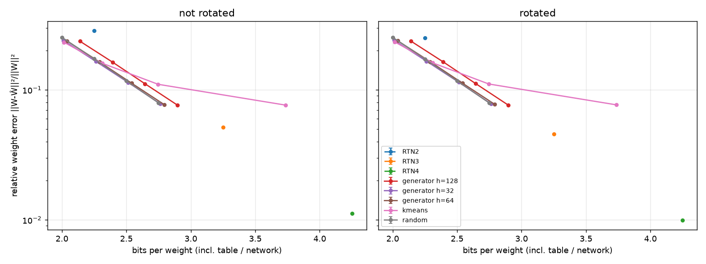
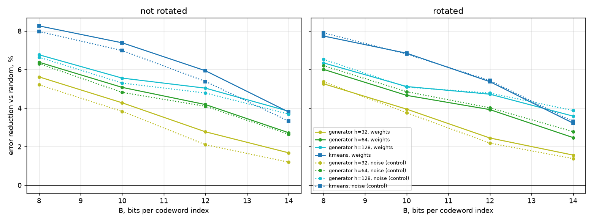
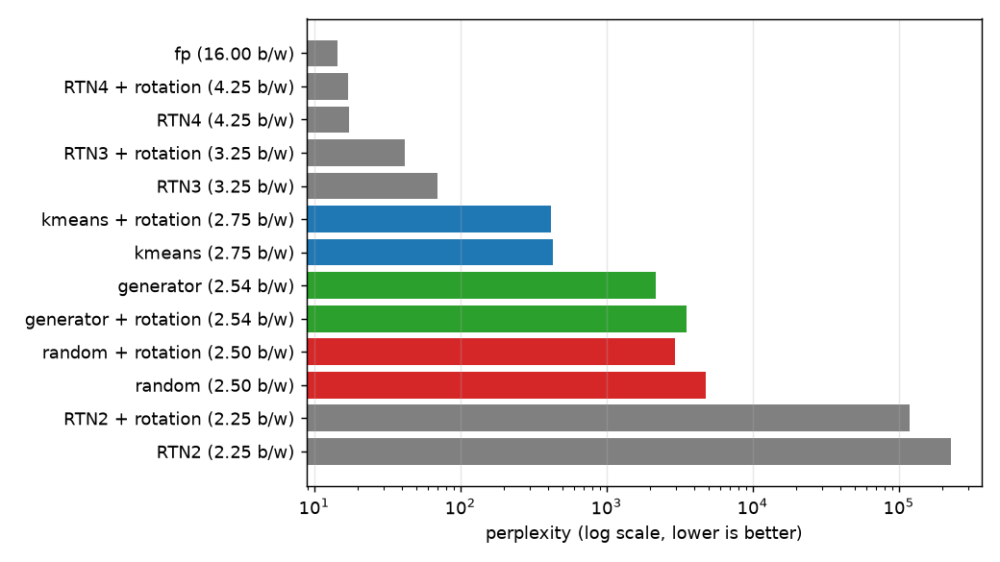

# Learned vs. random codebooks: full write-up

Model: Qwen/Qwen2.5-0.5B. GPU: RTX 3060 Laptop, 6 GB. All numbers come from the scripts in this repo. Raw data is in `results/grid.csv` (4480 rows) and `results/ppl.csv`; summary tables are in `results/tables.md`.

## Summary

1. A learned codebook beats a random one by ~4% weight error (generator, h=64, B=12). It beats random by the same ~4% on i.i.d. Gaussian noise of the same shape. The gain comes from codewords that cover the sphere more evenly, which works on any data. It does not come from structure in the model.
2. Rotation changes little: 4.2% without, 3.9% with. The only place with something that looks like real structure is `v_proj` without rotation, and rotation removes it.
3. Counting the generator's parameters, it is no better than random at equal bits per weight.
4. At ~2.5 bits per weight every method breaks the model. Perplexity for the generator is 2185-3543, versus 41.6-69.6 for 3-bit RTN and 14.5 for the original model.
5. As set up here (blocks of 8, one codeword plus a gain, plain weight error with no data), the idea is not worth pushing further. See the last section for what might be.

## Fixes to the first version of the script

The first version had a few problems that would have biased the comparison:

| problem | effect | fix |
|---|---|---|
| symmetric RTN with `qmax = 2^(b-1)-1` | only 3 of 4 levels used at 2 bits and 7 of 8 at 3 bits, so the baseline was too weak | asymmetric min-max RTN, group 128, fp16 scale and zero (+0.25 bits/weight) |
| fixed `N_TRAIN=200k` | `k_proj`/`v_proj` only have 14k blocks, so the test set was empty and the error was `nan` | hold out 20% of blocks for testing |
| k-means crashed when K > number of blocks | B=14 on small matrices | sample initial centroids with replacement |
| k-means table and generator weights not counted | unfair comparison | +K·8·16 bits for k-means, +16 bits per generator parameter (the generator is rounded to fp16 before evaluation) |
| k-means centroid was the signed mean | does not minimise the measured error ‖x‖² − (x·c)² | one power-iteration step per cluster |
| generator trained on normalised blocks | the error weights blocks by ‖x‖², the loss did not | train on unnormalised blocks |
| one-sided rotation | QuIP#/QTIP rotate both sides | `U W V` with random orthogonal U and V |
| generator backprop through an 8192×K matrix | slow | find the best codeword without autograd and backprop only through it; same gradient, 2.5x faster |

## One matrix

Layer 12, `down_proj`, B=12, mean of 3 seeds (std ≤ 0.0005):

| method | bits/weight | rel. error, not rotated | rotated |
|---|---|---|---|
| RTN2 | 2.25 | 0.302 | 0.250 |
| random | 2.50 | 0.1173 | 0.1172 |
| generator h=32 | 2.51 | 0.1138 | 0.1140 |
| generator h=64 | 2.52 | 0.1118 | 0.1124 |
| generator h=128 | 2.57 | 0.1110 | 0.1116 |
| kmeans | 2.62 | 0.1100 | 0.1107 |
| RTN3 | 3.25 | 0.0549 | 0.0457 |
| RTN4 | 4.25 | 0.0120 | 0.0099 |

Relative error is ‖W − Ŵ‖² / ‖W‖². The codebook methods at 2.5 bits lose 11-12% of it, 3-bit RTN loses about 5%.

## Grid

Layers 2, 12, 22 × 7 matrices × rotation on/off × B ∈ {8, 10, 12, 14} × hidden ∈ {32, 64, 128} × 3 seeds. As a control, I repeated it on i.i.d. Gaussian noise with the same shape and scale as each matrix (1 seed). If the generator gains as much on noise as on weights, it has not learned anything about the model.

Errors are averaged over all 21 matrices, weighted by size. Random, generator h=32 and h=64 sit on the same curve. h=128 is shifted right because its network costs more to store. k-means jumps right at B=14 because a 16384×8 table costs up to 18 bits per weight on the small matrices.

Error reduction vs. random, % (mean of 3 seeds, std ≤ 0.5):

| | B=8 | B=10 | B=12 | B=14 |
|---|---|---|---|---|
| generator h=64, weights, not rotated | 6.4 | 5.1 | 4.2 | 2.7 |
| generator h=64, noise, not rotated | 6.3 | 4.8 | 4.1 | 2.6 |
| generator h=64, weights, rotated | 6.0 | 4.7 | 3.9 | 2.5 |
| generator h=64, noise, rotated | 6.2 | 4.9 | 4.0 | 2.8 |
| kmeans, weights, not rotated | 8.3 | 7.4 | 5.9 | 3.8 |
| kmeans, noise, not rotated | 8.0 | 7.0 | 5.4 | 3.3 |

Solid lines are weights, dotted lines are noise. They nearly overlap.

Equal-bits comparison. The h=64 generator at B=12 averages 2.545 bits per weight: its network adds ~0.045 overall and up to 0.77 on the small k/v matrices. Extending the random curve to 2.545 bits (log-linear between B=12 and B=14, so this is an estimate) gives an error of about 0.109, against 0.1125 for the generator. That puts the generator about 3% behind at equal bits. On the large MLP matrices alone, where the network is cheap, it is about 2% ahead, but it would get the same 2% on noise.

Per layer and matrix (B=12, h=64; "above control" = gain on weights minus gain on noise, in points):

- MLP (`gate/up/down`), `q_proj`, `o_proj`: −0.7 to +0.9, i.e. zero within noise. No difference between layers.
- `v_proj`, not rotated: +5.0 (layer 2), +1.0 (layer 12), +8.3 (layer 22). This is the only clear signal. Rotated: −1.0 to −1.6, so rotation removes it.
- `k_proj`: −1.3 to +2.1. These matrices are small (14k blocks) and the control has 1 seed, so I read this as noise.

The full per-matrix table is in `results/tables.md`.

## Perplexity

All 7 linear layers in all 24 blocks were replaced (168 matrices). Embeddings, `lm_head` (tied to the embeddings), norms and biases were left alone. Perplexity is on the first 40 windows of 1024 tokens of WikiText-2 test (41k of 299k tokens), in bf16, with 1 seed, B=12 and h=64. The codebook is fitted to each whole matrix and its cost is counted.

| method | bits/weight | ppl, not rotated | rotated |
|---|---|---|---|
| original (bf16) | 16 | 14.5 | - |
| RTN4 | 4.25 | 17.2 | 17.0 |
| RTN3 | 3.25 | 69.6 | 41.6 |
| kmeans | 2.75 | 429 | 421 |
| generator h=64 | 2.54 | 2185 | 3543 |
| random | 2.50 | 4756 | 2930 |
| RTN2 | 2.25 | 226704 | 118299 |

- Nothing at ~2.5 bits survives without calibration. 3-bit RTN is better by one to two orders of magnitude. A 0.5B model has little redundancy, so this is the hardest case.
- k-means looks much better than the rest, but it pays for that in bits. On the small `k_proj`/`v_proj` a 4096×8 table almost memorises all 14k blocks. In layer 12, k-means gets `k_proj` error down to 0.044, but at 7.07 bits per weight (random: 0.117 at 2.5). Attention ends up with nearly uncompressed k/v, and the average is 2.75 bits per weight.
- The generator is better than random without rotation and worse with it, even though its weight error is lower in both cases. Once the model is this broken, perplexity is very sensitive, and this is one seed. I would not read anything into 2000 vs 4000.

## Answers

Is there structure in the weights that a generator can learn? Almost none. The whole gain over random (2.5-6.5% of the error) shows up on Gaussian noise too. The exception is `v_proj` without rotation in layers 2 and 22.

Does rotation erase it? Yes, but there is very little to erase. The average gain changes by 0.2-0.5 points, and the `v_proj` signal is gone after rotation.

Does it depend on layer or matrix type? Not on the layer. MLP and q/o behave like noise; `v_proj` shows some structure. On the small k/v matrices storage cost dominates: +0.77 bits per weight for an h=64 network and +18 for a k-means table at B=14.

Does the generator at ~2.5 bits beat 3-bit RTN in perplexity? No: 2185-3543 vs 41.6-69.6.

## Conclusion and next steps

I would not continue with this version. The learned generator only gains what it would also gain on noise, and its storage cost eats most of that. The bigger issue is the scheme itself: one codeword and an 8-bit gain per 8 weights loses ~11% of the weight energy at 2.5 bits, while 3-bit RTN loses 4.6-5.5%. A better codebook will not close that gap.

Things that look more promising, roughly in order:

1. Use data. Minimise the layer output error ‖XW − XŴ‖² on calibration activations (as in GPTQ/AWQ) instead of ‖W − Ŵ‖². This is where most of the gain at 2-3 bits comes from in the literature, and a generator could be trained on this loss directly.
2. Spend the bits differently. 8 bits for the gain is a lot. Try 4-5 bits for the gain and 3-4 more for the codeword, or several codewords per block, as real SeedLM does (several random vectors and coefficients) or as residual VQ does.
3. If a generator is still interesting, share one across the whole model or across one matrix type. Its cost then goes to almost zero, and it tests whether there is structure shared between layers. The `v_proj` result is a weak hint that there might be.
4. Repeat on a larger model (1.5B-3B); small models suffer the most from quantization.

## Limitations

- To keep the run under an hour the generator trains for 300 steps instead of 2000. On synthetic data this made its error ~2% worse, so it biases the result against the hypothesis, maybe by 1-2 points of gain. The noise control was trained the same way, so the comparison with it still holds.
- The grid measures error on held-out 20% of blocks; for perplexity the codebook is fitted on all blocks of a matrix. The held-out error is slightly pessimistic for k-means (0.109 vs 0.100 in-sample on `down_proj`).
- `random` is a simplified SeedLM: one PRNG codeword and one gain per block. The paper combines several LFSR vectors with several coefficients.
- The rotation is a Haar-random orthogonal matrix, not the randomized Hadamard used by QuIP#/QTIP, and there is no calibration after it.
- Perplexity is one seed on 40 × 1024 tokens (~14% of the test set). For broken models only the order of magnitude is meaningful.
- The noise control has 1 seed against 3 for real weights, so "above control" numbers for the small k/v matrices are noisy.
- The gain-quantizer range (2 floats per matrix) and the rotation seed are not counted; they are under 0.0001 bits per weight.
